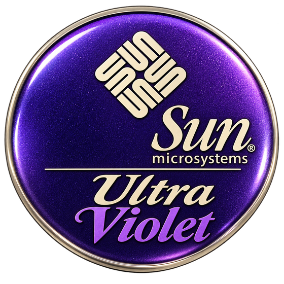

<p align="center">
  <br>
  <sub>Logo &copy; Andy Taylor (MW0MWZ)</sub>
</p>

# UltraViolet

An open-source emulator for Sun **UltraSPARC** workstations, starting with the
**Ultra 5** and **Ultra 10**: the UltraSPARC IIi processor with its on-chip
memory controller and PCI host bridge, the PCI I/O chipset, onboard ATI Rage
graphics and, on the Ultra 10, the UPA slot. The aim is to run the original
OpenBoot PROM and Solaris unmodified, at or above the speed of the real
machine, with a just-in-time compiler for the UltraSPARC IIi. Linux is the
primary host; macOS and Windows builds are planned from the start.

## Status

UltraViolet is at the very beginning. In place so far:

- **Ultra 5/10 machine:** the original OpenBoot PROM (3.31) runs its power-on
  sequence to the `ok` prompt on the serial console (ttya): it probes memory
  and the PCI buses, finds no keyboard or screen and uses ttya, prints its
  banner and answers commands. Modelled so far: the UltraSPARC IIi's PCI bus
  module (Sabre) with its IOMMU and interrupt mapping, the Advanced PCI
  Bridge (Simba), the PCIO EBus with the flash PROM, the M48T59 NVRAM and
  clock, the SuperIO's keyboard and mouse UARTs and floppy controller, the
  SAB82532 serial ports, the CMD646 IDE controller with an ATA disk and
  an ATAPI CD-ROM drive (bus-master DMA included), the on-board Happy
  Meal Ethernet with its PHY, the on-board ATI Rage Pro graphics, the
  CS4231 audio codec, the front-panel power button, and a Sun Type 5
  keyboard and mouse. OpenBoot finds them as its `disk`,
  `cdrom`, `net`, `screen` and `keyboard`, and takes the screen and
  keyboard as its console; `boot cdrom` boots Solaris 8 from its install
  media to the installer's first question, and the network passes
  OpenBoot's `test net` and gets an address by `boot net:dhcp`.
- **UltraSPARC IIi interpreter:** the SPARC V9 integer unit with register
  windows, trap levels and the global register sets, the I- and D-MMU with
  their TLBs and TSB pointers, the internal ASIs, TICK and interrupts, the
  floating-point unit and VIS 1.0, and a disassembler; decoded blocks are
  cached, and blocks run often are recompiled to x86-64 or AArch64 code.
- **Foundations:** the 41-bit physical address space, the event scheduler and
  host pacing, logging, guest memory, the x86-64 and AArch64 code emitters for
  the JIT, and user-mode (libslirp) and TAP networking.

Next come installing Solaris to disk and running its desktop (X on the
Rage Pro's drawing engine); see
[docs/ARCHITECTURE.md](docs/ARCHITECTURE.md).

## Building

You need:

- **CMake** 3.21 or later, **Ninja** (or make) and **pkg-config**;
- a **C++20 compiler**: GCC 12 or later, or Clang 15 or later;
- **SDL3** for the display window, keyboard and mouse. Without it the
  emulator still builds, but runs on the serial console (ttya) only (CMake
  warns when it cannot find SDL3);
- **libslirp** for user-mode networking (`--net user`). Without it only
  `--net tap:NAME` is available.

On **Debian 13** or **Ubuntu 25.04 and later** (including 26.04 LTS):

```sh
sudo apt install build-essential cmake ninja-build pkg-config libsdl3-dev libslirp-dev
```

On **Fedora**:

```sh
sudo dnf install gcc-c++ cmake ninja-build pkgconf-pkg-config SDL3-devel libslirp-devel
```

On **macOS** (Apple silicon or Intel), with the Xcode command-line tools for
the compiler and [Homebrew](https://brew.sh) for the rest:

```sh
xcode-select --install
brew install cmake ninja pkgconf sdl3 libslirp
```

On **Windows**, with [MSYS2](https://www.msys2.org): in its UCRT64 shell,

```sh
pacman -S mingw-w64-ucrt-x86_64-gcc mingw-w64-ucrt-x86_64-cmake mingw-w64-ucrt-x86_64-ninja \
          mingw-w64-ucrt-x86_64-pkgconf mingw-w64-ucrt-x86_64-sdl3 mingw-w64-ucrt-x86_64-libslirp
```

TAP networking is Linux-only; user-mode networking works everywhere.

Ubuntu 24.04 LTS and older releases do not package SDL3; build and install
it from source first ([SDL's build instructions](https://github.com/libsdl-org/SDL/blob/main/docs/README-cmake.md)),
or build without it for the serial console only. Distribution SDL3 packages
support both Wayland and X11 desktops; an SDL3 built from source needs the
Wayland and X11 development headers installed beforehand to support them.

Then, on every system, configure and build (the first command makes the
`build` folder; run it again after installing a missing library):

```sh
cmake -S . -B build -G Ninja -DCMAKE_BUILD_TYPE=Release
cmake --build build
ctest --test-dir build      # unit tests
```

Check the configure output: it says if SDL3 or libslirp was not found.

On macOS the build makes `build/UltraViolet.app`, a normal application
with the menus in the system menu bar (`build/ultraviolet` links to the
program inside it, for running from the terminal). Once it is built, to
make a copy that runs on its own, with the libraries it uses copied in and
signed for this Mac, in the Applications folder:

```sh
cmake --install build --prefix /Applications
```

No `sudo` is needed: an administrator account can write to /Applications.
(The `install_name_tool` warnings about invalidated signatures are expected:
the copy is signed again as the last step.)

On Windows, `build/ultraviolet.exe` runs from the MSYS2 shell; to run it
elsewhere, copy the DLLs it uses from `/ucrt64/bin` next to it.

## Running

```sh
./build/ultraviolet
```

opens the window with the machine off and the settings from last time
(Machine > Settings: processor clock, memory, console, keyboard layout, the
PROM folder, NVRAM, hard disk and CD-ROM images, network, timing). The
settings, a log and folders for ROMs, disk images and NVRAM are kept in
an UltraViolet folder in the user's Documents folder. The newest Ultra 5/10
flash PROM image in the PROM folder (`roms` beside the program, else the
UltraViolet folder's `roms`) is used.

Given a machine on the command line it powers on at once:

```sh
./build/ultraviolet --nvram disks/ultra10.nvram \
    --disk disks/ultra10.img --disk-size 8192 --cdrom iso/solaris.iso
```

The machine's screen is in the window, with the host's keyboard and mouse
as its Sun keyboard and mouse: click the screen to give it the mouse,
Ctrl+Alt+G (Ctrl+Option+G on a Mac) to take it back; Ctrl+Alt+A sends
Stop-A, Ctrl+Alt+E changes to the next CD in the set, Ctrl+Alt+F switches
to full screen. The Machine menu also has the front-panel power button, the
Sun keys a PC keyboard lacks (Stop, Again, Props and the rest), powering on
with keys held (Stop, Stop-D, Stop-F, Stop-N), and unplugging the keyboard.
The machine's audio, and the keyboard's bell and clicks, play on the host
(Settings, Sound). The serial ports have terminal windows (View menu), where
Pause or Ctrl+Shift+B sends a BREAK. With `--console ttya` there is no
keyboard, and OpenBoot and Solaris use ttya as the console (Ctrl+Alt+A then
sends a BREAK). `--headless` runs without a window, ttya on the terminal
(Ctrl-] then q quits; `~#` at the start of a line sends a BREAK). `--disk` is a raw image on the primary IDE channel
(created at `--disk-size` megabytes if it does not exist); `--cdrom` is an
ISO image in the CD-ROM drive (given more than once, a set of discs).
`--help` lists the rest.

The Ethernet is on user-mode networking by default when built with
libslirp (`--net user`: the guest is 10.0.2.15 behind a NAT, with DHCP and
DNS; `--hostfwd tcp:2222:22` forwards a host port to it), or on a TAP
interface (`--net tap:NAME`, Linux), or unplugged (`--net none`). `--mac`
sets the Ethernet address of a new NVRAM.

## Firmware and media

UltraViolet will need an OpenBoot PROM image from a real Ultra 5/10, and
Solaris (or another sparc64 operating system) media. Neither is included:
they are not part of this project and must come from your own machines and
media. The `roms/`, `iso/` and `disks/` folders are ignored by git for that
purpose.

## Legal

Copyright (C) 2026 Andy Taylor (MW0MWZ).

UltraViolet is free software; you can redistribute it and/or modify it under
the terms of the GNU General Public License as published by the Free Software
Foundation; either version 2 of the License, or (at your option) any later
version. See [LICENSE](LICENSE).

Sun, Ultra, Solaris and OpenBoot are trademarks of Oracle and/or its
affiliates. SPARC and UltraSPARC are trademarks of SPARC International, Inc.
UltraViolet is not affiliated with or endorsed by either.
