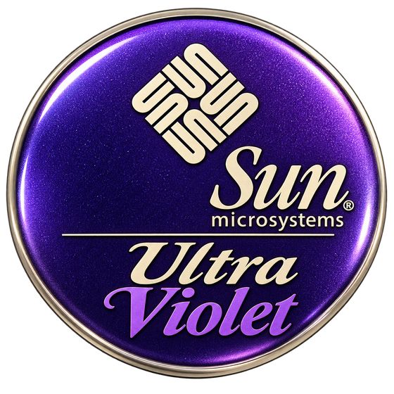
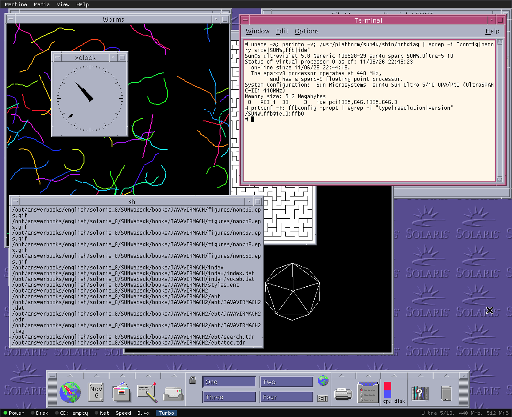
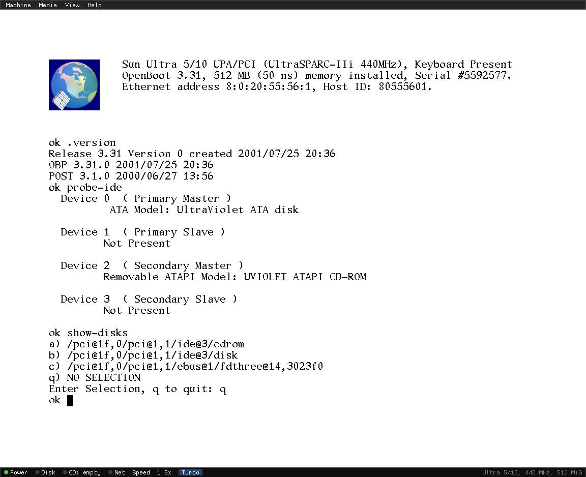
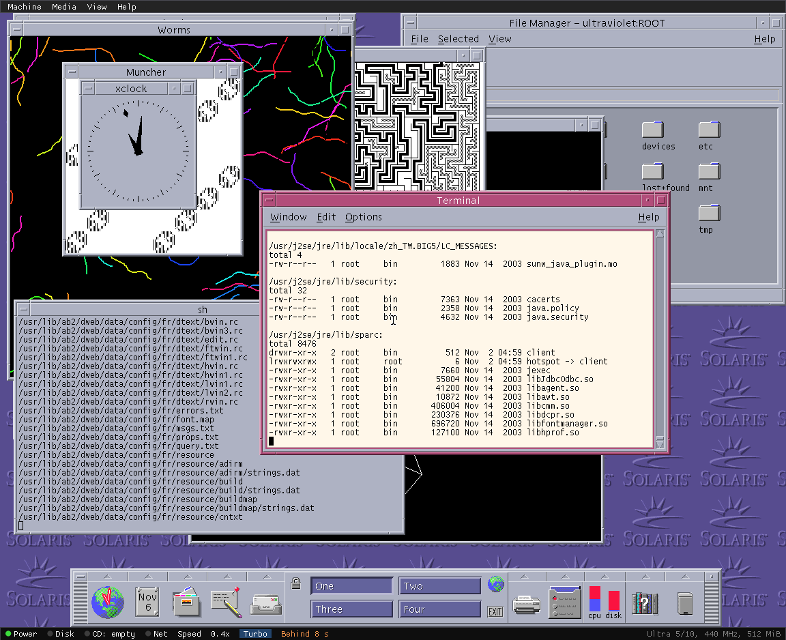
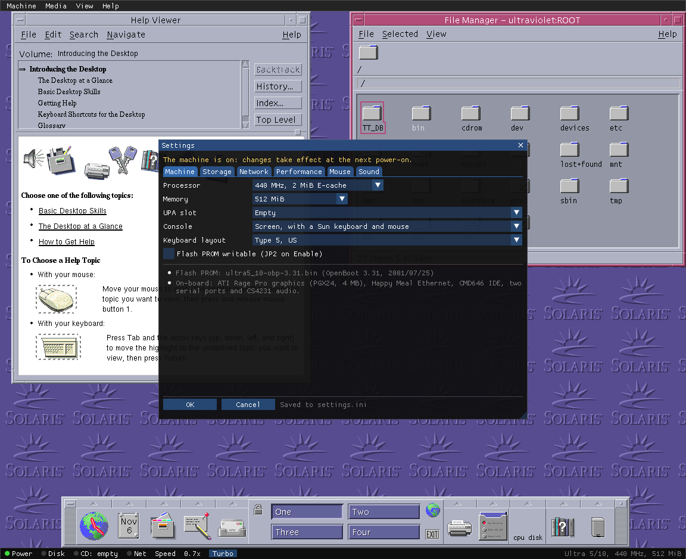

<p align="center">
  <br>
  <sub>Logo &copy; Andy Taylor (MW0MWZ)</sub>
</p>

# UltraViolet

An open-source emulator for Sun **UltraSPARC** workstations, starting with the
**Ultra 5** and **Ultra 10**: the sun4u (sparc64) platform's UltraSPARC IIi
processor with its on-chip memory controller and PCI host bridge, the PCI
I/O chipset, onboard ATI Rage graphics and, on the Ultra 10, the UPA slot.
The aim is to run the original OpenBoot PROM and Solaris unmodified, at or
above the speed of the real machine, with a just-in-time compiler for the
UltraSPARC IIi. It runs on Linux, macOS and Windows.

<p align="center">
  <br>
  <sub>Solaris 8 and CDE on the Ultra 10 with a Creator3D in the UPA slot</sub>
</p>

<table>
  <tr>
    <td width="33%"></td>
    <td width="33%"></td>
    <td width="33%"></td>
  </tr>
  <tr>
    <td align="center"><sub>OpenBoot 3.31</sub></td>
    <td align="center"><sub>CDE on the onboard Rage Pro</sub></td>
    <td align="center"><sub>Machine settings</sub></td>
  </tr>
</table>

## Status

UltraViolet runs the original OpenBoot PROM and real operating systems,
installed from their own media.

- **Machine:** OpenBoot 3.31 runs its power-on sequence and boots from
  disk, CD-ROM or the network, with the screen and keyboard or the serial
  port (ttya) as its console. Modelled: the UltraSPARC IIi's PCI bus module
  (Sabre) with its IOMMU and interrupt mapping, the Advanced PCI Bridge
  (Simba), the PCIO EBus with the flash PROM, the M48T59 NVRAM and clock,
  the SuperIO's keyboard and mouse UARTs and floppy controller, the
  SAB82532 serial ports, the CMD646 IDE controller with ATA disks and an
  ATAPI CD-ROM drive, the on-board Happy Meal Ethernet, the on-board ATI
  Rage Pro graphics with its drawing engine, the CS4231 audio codec, the
  front-panel power button, and a Sun Type 5 keyboard and mouse. The
  screen comes up at the resolution chosen in the settings (`--resolution`:
  640 x 480 to 1600 x 1200 on the Rage Pro), on a monitor that answers DDC
  with its EDID.
- **Creator3D:** a Creator3D (FFB2+) in the Ultra 10's UPA slot, with
  UltraViolet's own open source FCode for it built in
  ([firmware/creator3d](firmware/creator3d)), or Sun's FCode read from a
  real card (see [Firmware and media](#firmware-and-media)), at resolutions
  up to 1920 x 1200: OpenBoot takes it as its screen, with the FCode's
  banner logo; Solaris 8 and 9 run the
  CDE desktop on it and Solaris 10 its GNOME desktop, and NetBSD, OpenBSD
  and Linux their consoles. Its 2D drawing, window lookups, overlay and
  vertical retrace interrupt are modelled; its 3D operations are not yet.
- **Guests:** Solaris 8, 9 and 10 install from their media; Solaris 8 and 9
  run the CDE desktop on the Rage Pro, and Solaris 10 its GNOME desktop in
  24-bit colour. NetBSD/sparc64 (8.1 and 11.0), OpenBSD/sparc64 8.0 and
  Debian GNU/Linux 9 (sparc64, Linux 4.15) install to disk and boot to a
  login, with networking; OpenBSD runs X on the Rage Pro.
- **Processor:** the SPARC V9 integer unit with register windows, trap
  levels and the global register sets, the I- and D-MMU with their TLBs and
  TSB pointers, the internal ASIs, TICK and interrupts, the floating-point
  unit and VIS 1.0; decoded blocks are cached, and blocks run often are
  compiled to x86-64 or AArch64 code. Guest time keeps to the wall clock.
- **Front end:** a window with the machine's screen, its keyboard, mouse and
  sound on the host, menus and settings, and terminal windows for the serial
  ports; or headless, with ttya on the terminal. It builds on Linux, macOS
  and Windows.

Not done yet: the Creator3D's 3D operations, audio capture, audio CDs,
and the Blade 100/150 and Blade 1000/2000 machines. See
[docs/ARCHITECTURE.md](docs/ARCHITECTURE.md) for how it is put together.

## Performance

The same NetBSD/sparc64 8.1 disk image run under UltraViolet and under QEMU
10.0's sun4u machine, both with 256 MB of memory, on the same host each time.
UltraViolet ran with its default settings (guest time kept to the wall
clock, disks at the host's speed). Each figure is the median of three runs,
in seconds; lower is better. The last column is UltraViolet's speed as a
multiple of QEMU's: above 1x is faster, below 1x slower.

### x86-64 (2 cores)

| Test | What it does | QEMU 10.0 | UltraViolet | Relative to QEMU |
|---|---|---:|---:|---:|
| Process start | 300 runs of `/bin/echo` from the shell | 3.58 | 2.58 | 1.39x |
| awk | a 2-million-step integer loop | 17.09 | 7.64 | 2.24x |
| gzip | `gzip -6` of the kernel (10 MB) | 2.89 | 3.06 | 0.94x |
| md5 | `md5` of the kernel, three times | 1.55 | 0.86 | 1.80x |
| sort | sort the word list, forwards and in reverse | 2.41 | 1.31 | 1.84x |
| C compile | `cc -O2` of a 100-function source file | 18.89 | 12.33 | 1.53x |
| FP matrix | 160 x 160 double-precision matrix multiply, 20 times | 2.08 | 1.24 | 1.68x |
| FP library | 2 million rounds of `sin`, `cos` and `sqrt` | 3.37 | 2.01 | 1.68x |
| Page faults | touch every page of 32 MB, 8 times | 2.00 | 1.44 | 1.39x |
| memcpy | 8 MB copies, 120 times | 2.41 | 0.55 | 4.38x |
| Large fork | 300 forks of a 32 MB process | 2.76 | 1.87 | 1.48x |
| Disk write | 64 MB written with `dd`, then `sync` | 1.28 | 0.85 | 1.51x |
| Disk read | 128 MB read from the raw disk with `dd` | 1.47 | 0.87 | 1.69x |
| tar | `/usr/include` copied with `tar`, then `sync` | 10.28 | 5.57 | 1.85x |
| sleep | `sleep 10` | 10.01 | 10.00 | 1.00x |

### Apple M4 (arm64 Linux)

| Test | QEMU 10.0 | UltraViolet | Relative to QEMU |
|---|---:|---:|---:|
| Process start | 1.87 | 0.90 | 2.08x |
| awk | 11.86 | 3.06 | 3.88x |
| gzip | 2.08 | 1.90 | 1.09x |
| md5 | 1.05 | 0.40 | 2.63x |
| sort | 1.61 | 0.59 | 2.73x |
| C compile | 9.44 | 6.47 | 1.46x |
| FP matrix | 1.28 | 0.64 | 2.00x |
| memcpy | 1.45 | 0.45 | 3.22x |

UltraViolet is faster than QEMU in every timed test on the M4 (sleep only
checks the clock), and in all but one on the x86-64 host: gzip, which takes
about 6% longer there. Its time goes on short loops of translated code, most
of it on the loads of the data being compressed, each waiting on the one
before.

Both kept the guest's clock to the wall clock, to within a second over each
whole run. With Fast disk turned off in the settings (the disks at an
Ultra 10's own speed), on the x86-64 host the disk write takes 4.1 s, the
read 8.5 s and tar 10.4 s; the other figures do not change.

## Downloads

Ready-built programs are on the
[releases page](https://github.com/MW0MWZ/UltraViolet/releases). None of them
include firmware or operating system media: see
[Firmware and media](#firmware-and-media).

- **Linux** (x86-64 and arm64): an AppImage, for Ubuntu 22.04, Debian 12 or
  any distribution as new. Make it executable (`chmod +x`) and run it.
- **Windows** (x64): a zip. Unpack it and run `ultraviolet.exe`.
- **macOS** (15 or later, Apple silicon or Intel): a disk image. Open it and drag
  `UltraViolet.app` to Applications. It is not notarized, so before opening it
  the first time, clear the download mark:
  `xattr -dr com.apple.quarantine /Applications/UltraViolet.app`.

## Building

You need:

- **CMake** 3.21 or later, **Ninja** (or make) and **pkg-config**;
- a **C++20 compiler**: GCC 12 or later, or Clang 15 or later;
- **SDL3** for the display window, keyboard and mouse. Without it the
  emulator still builds, but runs on the serial console (ttya) only (CMake
  warns when it cannot find SDL3);
- **libslirp** for user-mode networking (`--net user`). Without it only
  `--net tap:NAME` is available.

On **Debian 13** or **Ubuntu 25.04 and later** (including 26.04 LTS):

```sh
sudo apt install build-essential cmake ninja-build pkg-config libsdl3-dev libslirp-dev
```

On **Fedora**:

```sh
sudo dnf install gcc-c++ cmake ninja-build pkgconf-pkg-config SDL3-devel libslirp-devel
```

On **macOS** (Apple silicon or Intel), with the Xcode command-line tools for
the compiler and [Homebrew](https://brew.sh) for the rest:

```sh
xcode-select --install
brew install cmake ninja pkgconf sdl3 libslirp
```

On **Windows**, with [MSYS2](https://www.msys2.org): in its UCRT64 shell,

```sh
pacman -S mingw-w64-ucrt-x86_64-gcc mingw-w64-ucrt-x86_64-cmake mingw-w64-ucrt-x86_64-ninja \
          mingw-w64-ucrt-x86_64-pkgconf mingw-w64-ucrt-x86_64-sdl3 mingw-w64-ucrt-x86_64-libslirp
```

TAP networking is Linux-only; user-mode networking works everywhere.

Ubuntu 24.04 LTS and older releases do not package SDL3; build and install
it from source first ([SDL's build instructions](https://github.com/libsdl-org/SDL/blob/main/docs/README-cmake.md)),
or build without it for the serial console only. Distribution SDL3 packages
support both Wayland and X11 desktops; an SDL3 built from source needs the
Wayland and X11 development headers installed beforehand to support them.

Then, on every system, configure and build (the first command makes the
`build` folder; run it again after installing a missing library):

```sh
cmake -S . -B build -G Ninja -DCMAKE_BUILD_TYPE=Release
cmake --build build
ctest --test-dir build      # unit tests
```

Check the configure output: it says if SDL3 or libslirp was not found.

On macOS the build makes `build/UltraViolet.app`, a normal application
with the menus in the system menu bar (`build/ultraviolet` links to the
program inside it, for running from the terminal). Once it is built, to
make a copy that runs on its own, with the libraries it uses copied in and
signed for this Mac, in the Applications folder:

```sh
cmake --install build --prefix /Applications
```

No `sudo` is needed: an administrator account can write to /Applications.
(The `install_name_tool` warnings about invalidated signatures are expected:
the copy is signed again as the last step.)

On Windows, `build/ultraviolet.exe` runs from the MSYS2 shell; to run it
elsewhere, copy the DLLs it uses from `/ucrt64/bin` next to it.

## Running

```sh
./build/ultraviolet
```

opens the window with the machine off and the settings from last time
(Machine > Settings: processor clock, memory, console, keyboard layout, the
PROM folder, NVRAM, hard disk and CD-ROM images, network, timing). The
settings, a log and folders for ROMs, disk images and NVRAM are kept in
an UltraViolet folder in the user's Documents folder. The flash PROM is
UltraViolet's own OpenBoot, built in; Machine > Settings (Flash PROM) or
`--prom supplied` takes the newest Ultra 5/10 image in the PROM folder
instead (`roms` beside the program, else the UltraViolet folder's `roms`),
such as Sun's OpenBoot 3.31.

Given a machine on the command line it powers on at once:

```sh
./build/ultraviolet --nvram disks/ultra10.nvram \
    --disk disks/ultra10.img --disk-size 8192 --cdrom iso/solaris.iso
```

At power-on the window is sized for the screen's resolution (Settings,
Resolution), shrunk to fit the desktop if need be; it can be resized freely
after that. The status bar's Turbo button lifts the speed limit while the
guest's clocks still follow the host's, so it keeps real time; Settings,
Performance, Turbo on at boot powers on with it on.

The machine's screen is in the window, with the host's keyboard and mouse
as its Sun keyboard and mouse: click the screen to give it the mouse,
Ctrl+Alt+G (Ctrl+Option+G on a Mac) to take it back (opening Settings takes it back too); Ctrl+Alt+A sends
Stop-A, Ctrl+Alt+E changes to the next CD in the set, Ctrl+Alt+F switches
to full screen. The Machine menu also has the front-panel power button, the
Sun keys a PC keyboard lacks (Stop, Again, Props and the rest), powering on
with keys held (Stop, Stop-D, Stop-F, Stop-N), and unplugging the keyboard.
The machine's audio, and the keyboard's bell and clicks, play on the host
(Settings, Sound). The serial ports have terminal windows (View menu), where
Pause or Ctrl+Shift+B sends a BREAK. With `--console ttya` there is no
keyboard, and OpenBoot and Solaris use ttya as the console (Ctrl+Alt+A then
sends a BREAK). `--headless` runs without a window, ttya on the terminal
(Ctrl-] then q quits; `~#` at the start of a line sends a BREAK). `--disk` is a raw image on the primary IDE channel
(created at `--disk-size` megabytes if it does not exist); `--cdrom` is an
ISO image in the CD-ROM drive (given more than once, a set of discs).
`--help` lists the rest.

The Ethernet is on user-mode networking by default when built with
libslirp (`--net user`; `--hostfwd tcp:2222:22` forwards a host port to the
guest), or on a TAP interface (`--net tap:NAME`, Linux), or unplugged
(`--net none`). `--mac` sets the Ethernet address of a new NVRAM.

On user-mode networking the guest is behind a NAT, and DHCP gives it:

| | |
|---|---|
| Address | 10.0.2.15, netmask 255.255.255.0 |
| Host name | `UltraViolet` |
| Domain | `home.arpa` (the domain reserved for local networks) |
| Gateway | 10.0.2.2 (the host) |
| DNS server | 10.0.2.3 |

These are fixed: each machine has a NAT of its own, so nothing else on that
network can clash with them. The DNS server answers the guest's own name, and its address back to that
name, in any domain: the one DHCP gives, or whatever domain an installer is
given, so a name-service check during an install succeeds. A name the guest
asks DHCP for is answered the same way, and so is an address query for no
name at all, which is how the Solaris installer looks up its own name before
it has set the one DHCP gave it. Other names go to the host's resolver.

## Firmware and media

UltraViolet runs OpenBoot, with Solaris (or another sparc64 operating
system) from its media. Its own OpenBoot is included and built in by
default: open source, built from Sun's OpenBoot 4.23.0 release for the
Ultra 5 and 10 ([firmware/openboot](firmware/openboot)). It is still being
completed (the Solaris 8 and 10 installation DVDs boot with it; its
diagnostics are to come); the Ultra 5/10's own Sun
OpenBoot (3.31) is chosen under Settings (Flash PROM) or with `--prom
supplied`. Sun's images and the operating systems are not included:
[roms/README.md](roms/README.md) says which images UltraViolet expects,
where they come from, and how to make them from the original Sun files with
the `sunrom` tool. The `roms/`, `iso/` and `disks/` folders are ignored by
git (but for that page).

For the Creator3D, open source FCode is included: UltraViolet's own
([firmware/creator3d](firmware/creator3d)), built into the program and used
by default, so the card needs no Sun firmware. If you have a real Creator3D,
you can read its own Sun FCode from the card's PROM in a running Solaris
system and use that instead: [tools/sunrom/README.md](tools/sunrom/README.md#reading-a-creator3ds-prom-solarisffbpromc)
says how, and [roms/README.md](roms/README.md#creator3d-fcode) what the
image should be. Put the image in the PROM folder, then choose it under
Settings (FCode) or with `--creator3d-fcode supplied`.

## Legal

Copyright (C) 2026 Andy Taylor (MW0MWZ).

UltraViolet is free software; you can redistribute it and/or modify it under
the terms of the GNU General Public License as published by the Free Software
Foundation; either version 2 of the License, or (at your option) any later
version. See [LICENSE](LICENSE).

The FCode in `firmware/creator3d` (the Creator3D's) and `firmware/rage`
(the Rage Pro's) is under the MIT licence; see their LICENSE files
([Creator3D](firmware/creator3d/LICENSE), [Rage Pro](firmware/rage/LICENSE)).

OpenBoot in `firmware/openboot` is Sun Microsystems' release of OpenBoot
4.23.0 under Sun's BSD-style licence, with UltraViolet's additions under the
same terms; see [its LICENSE](firmware/openboot/LICENSE).

The logos, UltraViolet's (in `graphics`) and those of the two FCode
programs (in `firmware/creator3d` and `firmware/rage`), are &copy; Andy
Taylor (MW0MWZ), all rights reserved: neither licence covers them.

Sun, Ultra, Solaris and OpenBoot are trademarks of Oracle and/or its
affiliates. SPARC and UltraSPARC are trademarks of SPARC International, Inc.
ATI and Rage are trademarks of Advanced Micro Devices, Inc.
UltraViolet is not affiliated with or endorsed by any of them.
