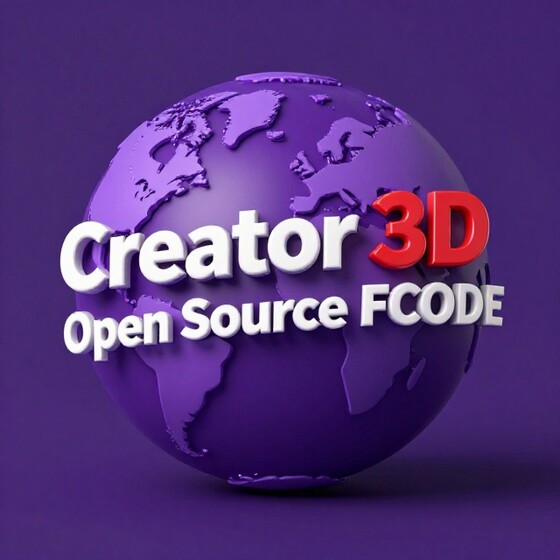
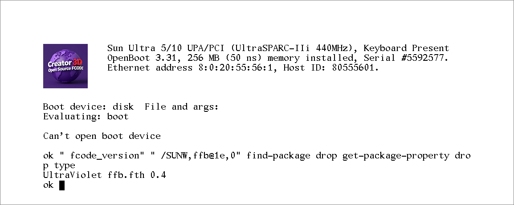

<p align="center">
  <br>
  <sub>Logo &copy; Andy Taylor (MW0MWZ)</sub>
</p>

# Creator3D FCode

Open source FCode for the Sun Creator3D (FFB2+, `SUNW,ffb`), the Ultra 10's UPA
graphics card. It is built into UltraViolet, so that the card can be
emulated without an image of its PROM, and it holds none of Sun's code.

It makes the card's device node with the properties a real card shows (the
board's type and the FBC's and DAC's revisions read from the card), reads
the monitor's EDID, sets the card up from cold in any of its video modes
(its clock, timing, window lookups and frame buffer configuration, as the
card's own FCode leaves them),
and gives OpenBoot its console through IEEE 1275's display interface, drawn
with the card's own fill, scroll and font operations and with its own
colour logo. Solaris attaches its Creator3D driver to
it and runs its window system on it.

It is written from the card's open documentation: the X.Org `sunffb`
driver's register definitions, the NetBSD, OpenBSD and Linux drivers,
`ffbconfig(1M)`'s list of video modes, and the card as it is seen working:
its properties, and the state it is left in for each mode.

<p align="center">
  <br>
  <sub>OpenBoot 3.31 on a Creator3D, with this FCode as the card's PROM</sub>
</p>

## Video modes

The mode is named after the device, as the card's own FCode takes it, in
`output-device` or wherever the screen is opened:

```
setenv output-device screen:r1280x1024x76
```

| Width x height | Rates (Hz) |
| --- | --- |
| 640 x 480 | 60, 60i (NTSC) |
| 768 x 575 | 50i (PAL) |
| 800 x 600 | 75 |
| 960 x 680 | 108s, 112s (stereo) |
| 1024 x 768 | 60, 70, 75, 77 |
| 1024 x 800 | 84 |
| 1152 x 900 | 66, 76 |
| 1280 x 800 | 76 |
| 1280 x 1024 | 60, 67, 75, 76, 85 |
| 1440 x 900 | 76 |
| 1600 x 1000 | 66, 76 |
| 1600 x 1200 | 75 |
| 1600 x 1280 | 76 |
| 1920 x 1080 | 72 |
| 1920 x 1200 | 70 |

From 1440 x 900 up the card is single-buffered. A name matches a mode when
it begins with the mode's name (so `r1600x1000x76i`, as `ffbconfig` writes
it, is 1600 x 1000 at 76 Hz). With no mode named, or one the card does not
have, the mode is the monitor's.

### The monitor's mode

The monitor's EDID is read over DDC when the card is probed and again when
the screen is opened: the first 128 bytes, from I2C address 0x50, tried up
to three times until they check (the header, and the bytes summing to 0).
From an EDID that checks, the mode is the first of its standard timings
that the card takes:

| Standard timings the card takes |
| --- |
| 640 x 480 at 60 Hz, 800 x 600 at 75 Hz |
| 1024 x 768 at 60, 70 and 75 Hz |
| 1280 x 1024 at 60, 67, 75, 76 and 85 Hz |
| 1600 x 1200 at 75 Hz, 1920 x 1080 at 72 Hz |

Failing that, it is the first the monitor has of these established timings:
1280 x 1024 at 75 Hz, 1024 x 768 at 75, 70 and 60 Hz, 800 x 600 at 75 Hz,
640 x 480 at 60 Hz. Its detailed timings are not used.

With no EDID that names a mode, it comes from the monitor's sense lines:

| Sense code | Mode |
| --- | --- |
| 0 | 1024 x 768 at 77 Hz |
| 2 | 1280 x 1024 at 76 Hz |
| 4 | 1280 x 1024 at 67 Hz |
| 5 | 1024 x 768 at 60 Hz |
| 6 | 1152 x 900 at 76 Hz |
| 1, 3, 7 (none) | 1152 x 900 at 66 Hz |

The node's `width`, `height`, `v_freq` and `monitor_mode` properties follow
the mode in use. `edid_data` holds the 128 bytes as last read (zeros when
no monitor answers), and `no_edid_blks` the number of blocks the EDID says
it has (the block and its extensions), or 0 when none checks.

## The logo

The banner's logo is a 100 x 100 picture in 24-bit colour, kept in the
card's PROM after the FCode, at PROM byte 0x4000, as a Sun raster file
([logo.ras](logo.ras): `RT_FORMAT_RGB`, no colour map). The FCode reads it
from the PROM and draws it at the text's left; a PROM without it gets
OpenBoot's own logo.

## Building

With `toke` from OpenBIOS's [fcode-utils](https://github.com/openbios/fcode-utils):

```sh
./build.sh
```

tokenizes `ffb.fth` and puts the FCode and the logo together as `ffb.fc`,
the PROM image (`TOKE=path/to/toke` if it is not on the `PATH`). `toke`
warns that it does not spread the bytes for `start4`: the card's PROM gives
a byte every 4 addresses, and the image is kept as the bytes themselves, as
a read of the card's PROM is.

UltraViolet builds `ffb.fc` in, and uses it unless the card's own FCode is
chosen; after a change to `ffb.fth`, `build.sh` remakes it (the build
refuses an `ffb.fc` whose version is not `ffb.fth`'s). A build of it put in
UltraViolet's `roms` folder can be chosen in its place.

## Licence

Unlike the rest of UltraViolet, this FCode is under the MIT licence (see
[LICENSE](LICENSE)), so that other emulators and firmware projects, and
owners of real cards, can use it freely.

The logo is not under the MIT licence: it is &copy; Andy Taylor (MW0MWZ),
all rights reserved. That covers the logo wherever it is here
([images/logo.jpg](images/logo.jpg), [logo.ras](logo.ras), and the copy of
it in the PROM image `ffb.fc`).
