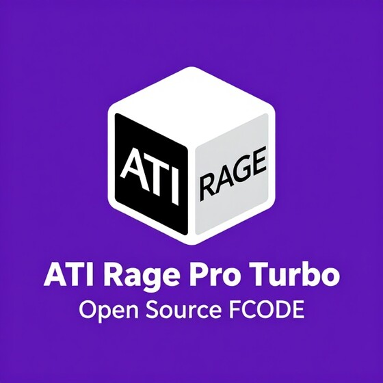
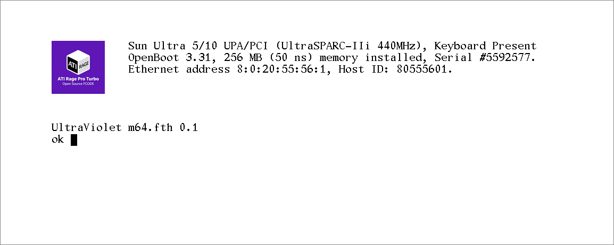

<p align="center">
  <br>
  <sub>Logo &copy; Andy Taylor (MW0MWZ)</sub>
</p>

# Rage Pro FCode

Open source FCode for the ATI Rage Pro (mach64 GT-C, `pci1002,4750`), the
graphics on the Ultra 5 and Ultra 10's motherboard and on Sun's PGX24 card
(`SUNW,m64B`). It holds none of Sun's or ATI's code, and is written to be
built into open source firmware for these machines.

It makes the chip's device node with the properties the onboard chip
shows, brings the chip up from cold (its bus interface, memory controller,
DAC and clock synthesiser, and its memory sized), reads the monitor's
EDID, sets the chip up in any of its video modes, and gives OpenBoot its
console through IEEE 1275's display interface in the 8-bit frame buffer,
with its own colour logo.

It is written from the chip's open documentation: the register
definitions of X.Org's mach64 driver and Linux's `atyfb`, and the chip as
it is seen working: its properties, the order in which it is brought up,
and the state it is left in for each mode.

<p align="center">
  <br>
  <sub>OpenBoot 3.31 on the Ultra 10's Rage Pro, its console drawn by this FCode</sub>
</p>

## Video modes

The mode is named after the device, as the chip's own FCode takes it, in
`output-device` or wherever the screen is opened:

```
setenv output-device screen:r1280x1024x76
```

| Width x height | Rates (Hz) |
| --- | --- |
| 640 x 480 | 60 |
| 800 x 600 | 75 |
| 1024 x 768 | 60, 70, 75, 77 |
| 1024 x 800 | 84 |
| 1152 x 900 | 66, 76 |
| 1280 x 800 | 76 |
| 1280 x 1024 | 60, 67, 75, 76, 85 |
| 1440 x 900 | 76 |
| 1600 x 1000 | 66, 76 |
| 1600 x 1200 | 60 |

Every mode is 8 bits a pixel. A name matches a mode when it begins with
the mode's name (so `r1280x1024x76junk` is 1280 x 1024 at 76 Hz). With no
mode named, or one the chip does not have, the mode is the monitor's.

### The monitor's mode

The monitor's EDID is read over DDC (the chip's GP_IO pins 13 and 12, as
SCL and SDA) when the chip is probed and again when the screen is opened:
the first 128 bytes, from I2C address 0x50, tried up to three times until
they check (the header, and the bytes summing to 0). From an EDID that
checks, the mode is the first of its standard timings that the chip
takes:

| Standard timings the chip takes |
| --- |
| 640 x 480 at 60 Hz, 800 x 600 at 75 Hz |
| 1024 x 768 at 60, 70, 75 and 77 Hz |
| 1280 x 1024 at 60, 67, 75, 76 and 85 Hz |

Failing that, it is the first the monitor has of these established timings:
1280 x 1024 at 75 Hz, 1024 x 768 at 75, 70 and 60 Hz, 800 x 600 at 75 Hz,
640 x 480 at 60 Hz. Its detailed timings are not used. With no EDID that
names a mode, it is 1152 x 900 at 66 Hz (the chip has no sense lines).

The node's `width`, `height`, `depth` and `linebytes` properties follow
the mode in use, and `edid` holds the 128 bytes when they check.

## The logo

The banner's logo is a 100 x 100 picture in 8-bit colour, a Sun raster file
with a colour map of its own ([logo.ras](logo.ras): `RT_STANDARD`,
`RMT_EQUAL_RGB`, 63 colours), kept in the FCode. It is drawn at the text's
left, its colours put in the palette from entry 0x10 (the console itself
uses white and black).

## Building

With `toke` from OpenBIOS's [fcode-utils](https://github.com/openbios/fcode-utils):

```sh
./build.sh
```

turns the logo into FCode data and tokenizes `m64.fth` behind a PCI
expansion ROM header (`TOKE=path/to/toke` if it is not on the `PATH`),
giving `m64.rom`: an image that OpenBoot runs from a PCI card's ROM, in
place of its own FCode for the chip. The Ultra 5 and 10's onboard chip has
no ROM: there the FCode is part of the system firmware.

## Licence

Unlike the rest of UltraViolet, this FCode is under the MIT licence (see
[LICENSE](LICENSE)), so that open source firmware projects, other emulators, and
owners of real machines can use it freely.

The logo is not under the MIT licence: it is &copy; Andy Taylor (MW0MWZ),
all rights reserved. That covers the logo wherever it is here
([images/logo.jpg](images/logo.jpg), [logo.ras](logo.ras), and the copy of
it in the ROM image `m64.rom`).
